<h1 align="center">
  
</h1>

---

<h1 align="center">
  
</h1>

---

### About Me

I'm a Computer Engineer currently pursuing a **Master's Degree in Internet of Things (IoT) at Universidad Carlos III de Madrid (UC3M)**.

I'm passionate about building technological solutions that combine software, hardware and intelligent systems. My main interests include Artificial Intelligence, IoT architectures, embedded systems and cybersecurity.

I enjoy working on multidisciplinary projects, from developing software applications and connecting IoT devices to experimenting with Vision-Language Models and autonomous systems.

I also have research experience at Universidad San Jorge, collaborating with the AOS research group.

**Areas of Interest:**
- Artificial Intelligence & Machine Learning
- Internet of Things (IoT) & Embedded Systems
- Computer Vision & Vision-Language Models
- Cybersecurity & Ethical Hacking
- Robotics & Autonomous Systems
- Software Engineering & System Integration

📫 Reach me at [Gmail](mailto:max.val.alv@gmail.com)

---

### Technologies & Tools

#### Programming Languages

  
  
  
  
  
  
  
  

#### Artificial Intelligence & Data Science

  
  
  
  
  
  

**Additional experience:** Large Language Models (LLMs), Vision-Language Models (VLMs), computer vision, prompt engineering, model evaluation and AI integration.

#### IoT & Embedded Systems

  
  
  
  
  

**Additional experience:** Sensor integration, embedded programming, telemetry, TCP/IP communication, data acquisition and IoT system integration.

#### Backend, Frontend & Databases

  
  
  
  
  

  
  
  
  

#### Cybersecurity & Pentesting

  
  
  
  
  
  
  

#### DevOps, Operating Systems & Other Tools

  
  
  
  
  
  
  
  
  
  

**Other tools:** LangSmith, OpenTelemetry, Unity, FileZilla and Autodesk Fusion 360.

---

### Achievements & Activities

- 🥇 1st Place – USJ Pentesting Hackathon 2024.
- 🥈 2nd Place – USJ Pentesting Hackathon 2025.
- 🥇 1st Place – Advent of Code USJ 2025.
- 🥈 2nd Place – NASA Space Apps Challenge Zaragoza.
- Active participant in hackathons and technology-related projects.

---

### Beyond Coding

When I'm not coding, I enjoy exploring the maker world, designing and 3D printing mechanical projects, building FPV drones and experimenting with electronics and hardware.

I'm also passionate about 3D modeling, mechanical design and developing creative hardware projects.

---

---

### Connect with Me

  

  

  

  

📫 **Email:** max.val.alv@gmail.com

---

⭐ If you like my profile, feel free to star my projects!
